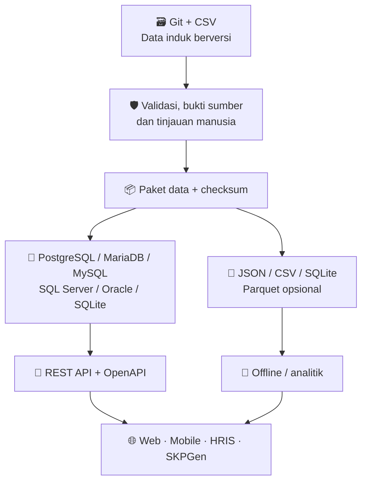
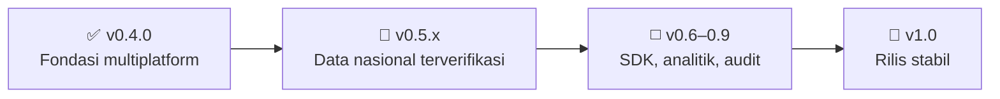

<div align="center">

# 🇮🇩 Registri Pekerjaan Indonesia
### RPI — Referensi pekerjaan, jabatan, dan pengupahan Indonesia

**Satu katalog terbuka. Banyak aplikasi. Data dengan sumber yang dapat ditelusuri.**

[](https://github.com/nasrulll/pekerjaan-indonesia/releases)
[](LICENSE)
[](DATA_LICENSE.md)
[](CONTRIBUTING.md)

[](https://github.com/nasrulll/pekerjaan-indonesia/actions/workflows/ci.yml)
[](https://github.com/nasrulll/pekerjaan-indonesia/actions/workflows/integrasi-sql.yml)

[**Mulai menggunakan**](#-mulai-dalam-3-langkah) · [**Jelajahi API**](#-api-berbahasa-indonesia) · [**Lihat cakupan data**](#-cakupan-data-saat-ini) · [**Ikut berkontribusi**](#-berkontribusi)

</div>

---

> [!IMPORTANT]
> **RPI belum merupakan daftar resmi lengkap seluruh pekerjaan di Indonesia.** RPI v0.4.0 menyediakan katalog **kurasi awal** dan infrastruktur teknis. Kode KBJI, wilayah administratif, UMP/UMK, dan statistik upah **tidak akan dipublikasikan sebagai data resmi sebelum sumber serta izinnya diverifikasi**.

## ✨ Sekilas RPI

| **811** | **39** | **10** | **6** |
|:---:|:---:|:---:|:---:|
| Judul pekerjaan **draf** | Kelompok sektor editorial | Kelompok utama KBJI sebagai referensi | Keluarga database SQL yang disiapkan |
| Belum tervalidasi satu per satu terhadap KBJI | **Bukan** kode KBLI | **Bukan** pemetaan KBJI per pekerjaan | Tingkat pengujian berbeda-beda |

**RPI membantu pengembang dan pengelola data** mencari judul pekerjaan, menata jabatan organisasi, menyiapkan referensi wilayah, serta menyajikan statistik pengupahan **hanya jika datanya memiliki sumber yang sah dan jelas**.

### Apa yang sudah bisa digunakan?

- 🧭 **Katalog pekerjaan** — ID stabil, judul, sektor, alias, pencarian, dan filter.
- 🏢 **Struktur jabatan** — representasi jabatan organisasi dan hubungannya dengan pekerjaan.
- 🌏 **Struktur wilayah & upah** — skema dan endpoint tersedia, menunggu data resmi.
- 🔌 **REST API baca-saja** — endpoint Indonesia, kompatibilitas endpoint versi sebelumnya, OpenAPI.
- 🗂️ **Ekspor multiplatform** — SQLite, CSV, JSON, SHA-256; Parquet tersedia sebagai skrip opsional.
- 🧩 **Interoperabilitas** — SQLAlchemy, contoh SDK enam bahasa, dan skema lintas database.
- 🔍 **Audit data** — kontrol sumber, edisi, lisensi, checksum, dan peninjauan manusia.

## 📊 Cakupan data saat ini

| Dataset | Isi yang sudah tersedia | Status |
|---|---:|---|
| Pekerjaan | **811** entri | 🟡 Kurasi draf |
| Sektor editorial | **39** | 🟡 Pengelompokan internal |
| Kelompok utama KBJI | **10** | 🔵 Referensi tingkat kelompok |
| Contoh jabatan nasional | **3** | 🟡 Draf |
| Pemetaan pekerjaan ke kode KBJI resmi | **0** | ⚪ Menunggu sumber |
| Wilayah administratif resmi terverifikasi | **0** | ⚪ Menunggu sumber |
| Rekaman UMP/UMK terverifikasi | **0** | ⚪ Menunggu sumber |
| Statistik rata-rata/median upah | **0** | ⚪ Menunggu sumber |
| Pemetaan internasional terverifikasi | **0** | ⚪ Menunggu sumber |

**Mengapa beberapa tabel kosong?** Karena **tidak tersedia** berbeda dari **bernilai nol**. Angka upah tidak diestimasi diam-diam, nama jabatan tidak otomatis menjadi kode KBJI, dan data pihak ketiga tidak disalin tanpa pemeriksaan izin.

> [!NOTE]
> Untuk penggunaan analitis atau kebijakan, periksa **edisi, definisi variabel, asal sumber, cakupan wilayah, periode, dan status verifikasi** sebelum memakai suatu dataset. UMP/UMK adalah ketentuan upah minimum, **bukan rata-rata gaji**.

## 🏗️ Cara RPI bekerja



**Prinsip utama:** Git dan dataset CSV tervalidasi adalah sumber versi data. Database operasional merupakan salinan untuk menjalankan layanan; tidak boleh berkembang menjadi sumber data yang saling bertentangan.

## 🚀 Mulai dalam 3 langkah

Persyaratan: **Python 3.10+**, Git, dan pip. Cara paling sederhana menggunakan SQLite lokal.

**1. Kloning repositori dan pasang dependensi**

```bash
git clone https://github.com/nasrulll/pekerjaan-indonesia.git
cd pekerjaan-indonesia
python -m pip install -e '.[server,test]'
```

**2. Validasi dan bangun paket data**

```bash
python scripts/validate.py
python -m unittest discover -s tests -v
python scripts/build_release.py
```

**3. Jalankan REST API**

```bash
uvicorn nor_id.api:app --host 127.0.0.1 --port 8000
```

Buka **[Swagger UI lokal](http://127.0.0.1:8000/docs)** setelah API berjalan, atau akses spesifikasi **[OpenAPI JSON lokal](http://127.0.0.1:8000/openapi.json)**. Alamat lokal tersebut bukan layanan publik yang telah di-deploy.

<details>
<summary><strong>⚙️ Jalankan pada database selain SQLite</strong></summary>

Gunakan `RPI_DATABASE_URL` dan driver yang sesuai; contoh migrasi dan pengujian ada dalam [panduan interoperabilitas](docs/INTEROPERABILITAS.md).

```bash
# Inspeksi tanpa menulis data
python scripts/impor_multibasis.py

# Contoh hanya untuk database SQLite BARU yang kosong:
RPI_DATABASE_URL='sqlite+pysqlite:////tmp/rpi.sqlite3' \
  python scripts/impor_multibasis.py --buat-skema --terapkan
```

**Jangan gunakan** `--buat-skema` terhadap database produksi yang sudah memiliki tabel. Jangan memasukkan kata sandi database dalam commit Git.
</details>

## 🔌 API berbahasa Indonesia

| Endpoint | Kegunaan |
|---|---|
| `GET /healthz` | Pemeriksaan kesehatan layanan |
| `GET /v1/status-registri` | Ringkasan status dan ketersediaan data |
| `GET /v1/pekerjaan?nama=perawat` | Filter judul pekerjaan |
| `GET /v1/cari-pekerjaan?kata=guru` | Pencarian berdasarkan kata kunci |
| `GET /v1/jabatan?nama=kepala` | Katalog jabatan |
| `GET /v1/wilayah?jenis_wilayah=provinsi` | Referensi wilayah, bila tersedia |
| `GET /v1/upah-minimum?tahun=2026` | UMP/UMK **hanya jika data terverifikasi tersedia** |
| `GET /v1/statistik-upah?tahun=2026` | Statistik upah **hanya jika tersedia** |

```bash
curl 'http://127.0.0.1:8000/v1/cari-pekerjaan?kata=guru'
```

Endpoint lama seperti `/v1/occupations` tetap dipertahankan untuk kompatibilitas. Lihat [dokumentasi API](docs/API.md), [contoh SDK](sdk/README.md), dan [dashboard awal](dashboard/index.html).

## 🛢️ Dukungan database

| Teknologi | Status dukungan |
|---|---|
| **SQLite** | ✅ Snapshot dan impor lokal teruji |
| **PostgreSQL** | ✅ Impor, impor ulang, dan API lulus pengujian integrasi GitHub Actions |
| **MariaDB** | ✅ Impor, impor ulang, dan API lulus pengujian integrasi GitHub Actions |
| **MySQL** | 🧪 Adapter dan DDL disiapkan; pengujian server nyata belum selesai |
| **Microsoft SQL Server** | 🧪 Adapter/DDL disiapkan; pengujian server nyata belum selesai |
| **Oracle** | 🧪 Adapter/DDL disiapkan; pengujian server nyata belum selesai |
| **Parquet / DuckDB** | 🧪 Alur analitik opsional; belum tervalidasi menyeluruh |

Pengujian [PostgreSQL/MariaDB](https://github.com/nasrulll/pekerjaan-indonesia/actions/workflows/integrasi-sql.yml) merupakan pengujian di CI, **bukan sertifikasi siap produksi**.

## 🗺️ Roadmap pengembangan



**Fokus v0.5.0:** audit KBJI resmi, kode wilayah, keputusan UMP/UMK, dan nomenklatur jabatan berdasarkan publikasi yang dapat diperiksa. Tahap ini dikerjakan melalui branch pengembangan dan Pull Request, **bukan** perubahan diam-diam pada rilis bertag.

| Prioritas | Pekerjaan |
|---|---|
| P0 | [#1 Audit dan impor KBJI resmi](https://github.com/nasrulll/pekerjaan-indonesia/issues/1) |
| P0 | [#2 Wilayah provinsi/kabupaten/kota](https://github.com/nasrulll/pekerjaan-indonesia/issues/2) |
| P0 | [#3 UMP dan UMK historis](https://github.com/nasrulll/pekerjaan-indonesia/issues/3) |
| P1 | [#4 Jabatan nasional](https://github.com/nasrulll/pekerjaan-indonesia/issues/4) · [#5 Statistik upah](https://github.com/nasrulll/pekerjaan-indonesia/issues/5) · [#6 Pengujian database dan SDK](https://github.com/nasrulll/pekerjaan-indonesia/issues/6) |
| P2 | [#7 Portal data publik](https://github.com/nasrulll/pekerjaan-indonesia/issues/7) |

Lihat [roadmap lengkap](docs/ROADMAP.md) dan [catatan perubahan](CHANGELOG.md).

## 🤝 Berkontribusi

Kontribusi dapat berupa usulan judul pekerjaan, koreksi sinonim, rujukan regulasi, perbaikan dokumentasi, atau hasil verifikasi dataset.

1. **[Cari issue terlebih dahulu](https://github.com/nasrulll/pekerjaan-indonesia/issues)** agar tidak menggandakan pekerjaan.
2. Cantumkan sumber primer, edisi, definisi, dan ketentuan penggunaan ulang jika mengusulkan data resmi.
3. Kirim Pull Request dengan pengujian serta penjelasan perubahan.
4. Pemetaan KBJI dan statistik resmi harus melewati **peninjauan manusia** sebelum diterbitkan.

Baca [CONTRIBUTING.md](CONTRIBUTING.md) dan [kebijakan sumber data](docs/SOURCE_POLICY.md).

## 📚 Dokumentasi & integrasi

| Panduan | Penjelasan |
|---|---|
| [Arsitektur sistem](docs/ARCHITECTURE.md) | Komponen, aliran data, dan kontrak sistem |
| [Kamus data](docs/DATA_DICTIONARY.md) | Struktur dan definisi entitas |
| [API](docs/API.md) | Endpoint dan format respons |
| [Interoperabilitas](docs/INTEROPERABILITAS.md) | Mesin SQL, migrasi, dan batasan dukungan |
| [Penyegaran data](docs/PENYEGARAN_DATA.md) | Verifikasi paket dan jejak sumber |
| [Integrasi SKPGen](docs/INTEGRATION_SKPGEN.md) | Contoh skenario integrasi, **belum terhubung langsung** |
| [Keamanan dan kinerja](docs/KEAMANAN_KINERJA.md) | Gerbang sebelum rilis produksi |

## ⚖️ Lisensi, sumber & tanggung jawab data

- **Kode dan kontribusi asli:** lisensi [MIT](LICENSE).
- **Dataset eksternal:** tunduk pada hak cipta, atribusi, serta syarat penggunaan masing-masing penerbit; lihat [DATA_LICENSE.md](DATA_LICENSE.md).
- **RPI bukan lembaga pemerintah** dan tidak mengklaim mewakili BPS, Kementerian Ketenagakerjaan, atau instansi lainnya.
- **Tidak menyimpan data gaji per individu** dalam katalog publik. Statistik agregat tetap memerlukan pemeriksaan privasi.

---

<div align="center">

**🇮🇩 Bangun ekosistem data pekerjaan Indonesia yang terbuka, terlacak, dan dapat digunakan bersama.**

[📂 Repositori](https://github.com/nasrulll/pekerjaan-indonesia) · [🛠️ Issues](https://github.com/nasrulll/pekerjaan-indonesia/issues) · [📖 Dokumentasi](docs/) · [🔖 Tag rilis](https://github.com/nasrulll/pekerjaan-indonesia/tags)

<sub>RPI v0.4.0 — baseline terkunci · v0.5.0 dalam pengembangan</sub>

</div>
