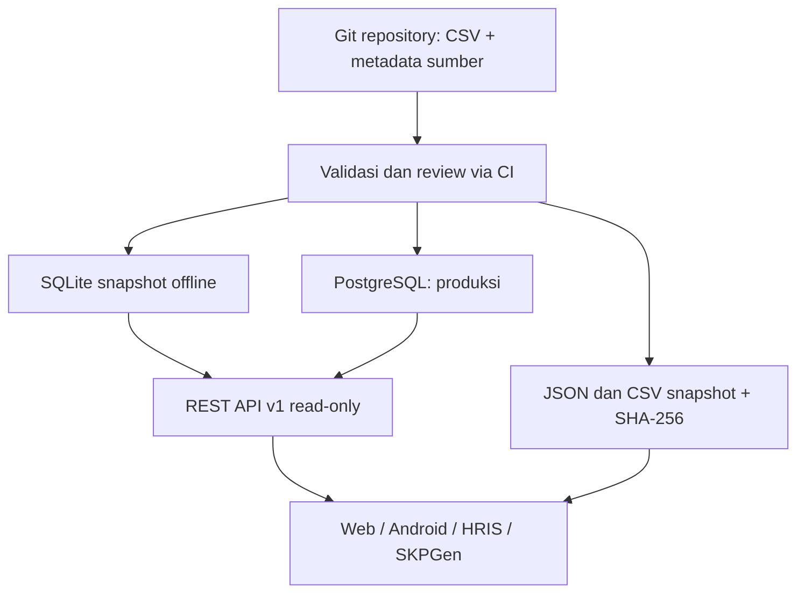

# Arsitektur NOR-ID Multiplatform v0.2.0

## Aliran data

## Keputusan arsitektur

- **Git/CSV sumber kebenaran**, bukan PostgreSQL. Data resmi hanya diterima dengan provenance/edisi/verifikator; API tidak membuat kode KBJI secara otomatis.
- **PostgreSQL sumber pembacaan produksi** melalui `NOR_DATABASE_URL`. Loader PostgreSQL bekerja secara transaksional dengan UPSERT; tidak melakukan penghapusan data tanpa perubahan eksplisit.
- **SQLite sebagai replika lokal**, dibuat atomik dari CSV. Tidak memerlukan server DB. `scripts/build_release.py` menghasilkan SQLite, JSON, CSV beserta manifest checksums.
- **REST API v1** menggunakan FastAPI + SQLAlchemy, dengan satu kontrak API untuk SQLite maupun PostgreSQL. Baca-saja; fitur admin/penyuntingan tidak ada pada rilis ini.
- **JSON/CSV ekspor** memudahkan penggunaan lintas bahasa/perangkat. File JSON offline bersifat array; JSON yang diunduh dari API memiliki `{api_version, notice, data}`. Konsumen harus memperhatikan perbedaan ini.
- **Pencarian** menggunakan pencocokan substring, bukan fuzzy search. Batas per halaman 100; hasil dipaginasi dan diurutkan deterministik.

## Entitas inti

`occupations` 1..n `job_titles`, `occupations` 1..n `kbji_mappings`, `occupations` n..1 `sectors`, `occupations` n..1 `data_sources`, `occupations` 1..n `occupation_aliases`, `job_titles` n..1 `employment_contexts`.

Nama internal `preferred_name_id`, `kbji_label_id`, dan `title_name_id` saat ini berisi teks Bahasa Indonesia, bukan ID terjemahan terpisah. Jangan menggantinya tanpa migrasi kompatibilitas.

## Keamanan dan operasional

- API hanya GET; tulisan ke database lewat jalur operator/loader saja, dan butuh `--apply`.
- Query API diparameterisasi; input dibatasi panjang, pagination, dan pencarian literal. CORS nonaktif kecuali origin tepercaya diatur.
- Gunakan TLS, database role **read-only untuk API**, reverse proxy dengan rate limit, backup dan observabilitas saat deploy di internet. Docker Compose ini untuk pengembangan/lokal, bukan konfigurasi hardening produksi.
- Snapshot hanya berisi profesi, bukan data pribadi pengguna. Tidak diperlukan mengirim NIK/riwayat ke repositori publik.

## Keterbatasan v0.2.0

- **Semua 811 pekerjaan masih draft**. Mapping KBJI resmi masih nol; 39 sektor adalah editorial.
- Belum tersedia import klasifikasi resmi KBJI lengkap, taxonomy hierarkis, fuzzy ranking, multilingual, ataupun pengelolaan jabatan ASN yang terverifikasi.
- Loader melakukan UPSERT, bukan rekonsiliasi penghapusan. Perubahan yang menghapus record dari CSV wajib diaudit/manual migrasi PostgreSQL agar rekonsiliasi tidak menyisakan data usang.
- Kode PostgreSQL dan Docker belum diuji di server PostgreSQL riil dalam sesi pengembangan ini; jangan menyebut deploy produksi selesai sebelum smoke test DB dijalankan.
