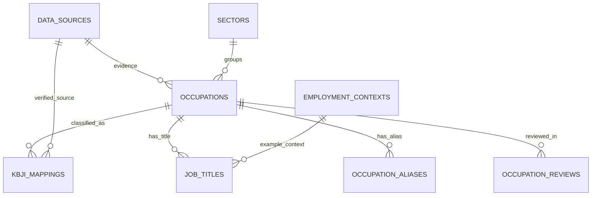

# Kamus Data

## Entitas dan hubungan

## `data/occupations.csv`

| Kolom | Deskripsi |
|---|---|
| `occupation_id` | ID internal stabil: `ID-OCC-NNNNNN` |
| `preferred_name_id` | Nama pekerjaan utama bahasa Indonesia |
| `alternative_names` | Sinonim; pisahkan dengan `|` dalam CSV |
| `sector_id` | FK ke `reference/sectors.csv`, bukan kode KBLI |
| `description_id` | Definisi tugas (kosong sampai kurasi) |
| `source_id` | FK ke `sources.csv` |
| `record_status` | `draft`, `reviewed`, `published`, `archived` |
| `last_reviewed` | Tanggal tinjau `YYYY-MM-DD` atau kosong |

## `data/kbji_mappings.csv`

| Kolom | Deskripsi |
|---|---|
| `occupation_id` | FK internal |
| `kbji_edition` | Versi/edisi sumber KBJI yang diperiksa |
| `kbji_code` | Kode resmi sebagai **string**; panjang sesuai sumber |
| `kbji_label_id` | Label persis dari entri resmi yang dirujuk |
| `source_id` | FK sumber publikasi/dokumen yang diizinkan |
| `verified_by` | Pemeriksa manusia |
| `verified_at` | Tanggal pemeriksaan |

Kardinalitas pekerjaan ↔ KBJI dapat berubah antaredisi dan konteks. Karena itu mapping dipisahkan dari entri pekerjaan. **Tidak ada mapping resmi yang disertakan pada seed v0.1.0.**

## `reference/employment_contexts.csv`

Satu kategori dapat mewakili berbagai dimensi, misalnya `employment_status` (PNS/PPPK), `employer_sector` (BUMN/BUMD/swasta/yayasan), atau `work_arrangement` (wirausaha, freelance, informal). Kategori ini **tidak saling eksklusif antar dimensi**. Di tahap selanjutnya, model per-orang/per-kontrak membutuhkan tabel terpisah yang dapat menyimpan gabungan beberapa konteks.

## `data/job_titles.csv`

Contoh jabatan dalam lembaga/perusahaan. Jabatan sering berubah berdasarkan organisasi; tidak semua jabatan adalah pekerjaan baru dalam KBJI.

## Rencana normalisasi tambahan

Pada tahap berikutnya: `occupation_specializations`, `occupation_competencies`, `education_requirements`, `professional_licenses`, `asn_job_catalogs` (jabatan fungsional/pelaksana/struktural sesuai regulasi), `organization_titles`, `occupation_kbli_relations`, `occupation_translations`, dan `taxonomy_change_log`. Semua diberikan provenance dan validitas tanggal.
