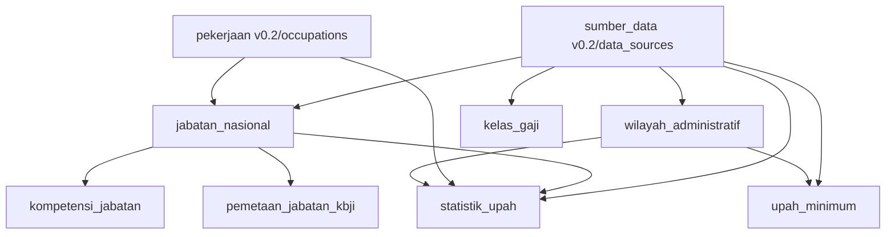

# Pengembangan RPI v0.3 — pekerjaan, jabatan, wilayah, dan pengupahan

## Kebijakan penamaan

Nama aplikasi: **Registri Pekerjaan Indonesia (RPI)**. Kode repo: `pekerjaan-indonesia`. Nama file, tabel, kolom, modul dan rute baru memakai Bahasa Indonesia. Tabel dan endpoint berbahasa Inggris dari v0.2 masih tersedia untuk menjaga kompatibilitas integrasi yang telah ada. Paket Python internal `nor_id` dipertahankan sebagai jalur impor stabil, bukan merek produk baru.

## Diagram logis



## Struktur baru

| Tabel | Peran | CSV kanonik |
|---|---|---|
| `jabatan_nasional` | Nama jabatan, induk, jenjang, pekerjaan terkait, konteks, sumber dan status | `data/jabatan_nasional.csv` |
| `wilayah_administratif` | Sistem kode, kode wilayah, nama, jenis, induk dan sumber | `data/wilayah_administratif.csv` |
| `pemetaan_jabatan_kbji` | Hubungan jabatan-ke-kode KBJI **yang diverifikasi saja** | `data/pemetaan_jabatan_kbji.csv` |
| `kompetensi_jabatan` | Persyaratan kompetensi berdasarkan jabatan | `data/kompetensi_jabatan.csv` |
| `upah_minimum` | UMP/UMK per wilayah dan tahun dengan dokumen sumber | `data/upah_minimum.csv` |
| `statistik_upah` | Statistik tahun/wilayah/pekerjaan/jabatan; pisahkan metrik dan kategori data | `data/statistik_upah.csv` |
| `kelas_gaji` | Kelas/golongan dan nilai dasar bila relevan | `data/kelas_gaji.csv` |
| `riwayat_impor` | Audit impor operasional pada database | belum memakai CSV master |

### Aturan struktural

- `wilayah_administratif` memakai kunci gabungan `(sistem_kode,kode_wilayah)` agar kode BPS dan kode Kemendagri tidak bertabrakan. Kabupaten/kota harus berinduk provinsi pada sistem kode yang sama.
- `upah_minimum` memakai `jenis_upah=UMP/UMK`, `tahun`, `tanggal_mulai`, `nilai_rupiah`, `sumber_id`, `status_verifikasi`. UMP hanya boleh di provinsi, UMK hanya kabupaten/kota. Belum ada pengelolaan UMK sektoral dalam rilis ini.
- `statistik_upah` memakai `metrik` (`rata_rata`, `median`, `persentil_25`, `persentil_75`), `satuan` (`per_bulan`, `per_jam`), `cakupan_pekerja`, `jenis_data` (`resmi`, `survei`, `estimasi`), `jumlah_sampel` opsional dan status verifikasi. Baris dapat berlaku untuk seluruh pekerjaan suatu daerah ketika `id_pekerjaan`/`id_jabatan` kosong; jangan memaksa per jabatan jika publikasi tidak menyediakan rincian itu.
- Nominal disimpan sebagai **rupiah utuh**; tidak ada kolom upah rata-rata permanen pada katalog pekerjaan. Hasil analisis penyesuaian inflasi dan perbandingan mata uang bukan bagian dari data mentah.
- Data terverifikasi memerlukan tanggal dan sumber yang memiliki URI bukti. Kode KBJI tidak boleh ditebak dari nama.
- Tidak semua wilayah menerbitkan statistik upah menurut pekerjaan; gunakan nilai belum tersedia, bukan nol atau hasil estimasi yang disamarkan.

## Proses impor data resmi (masih manual)

1. Tentukan edisi KBJI, sistem kode administrasi, atau tahun peraturan pengupahan yang dibutuhkan.
2. Ambil berkas resmi dengan hak penggunaan ulang yang jelas. Catat instansi, judul, URL, edisi dan ketentuan lisensi di `data/sources.csv`.
3. Siapkan baris CSV terpisah (tidak menimpa identitas pekerjaan) dan gunakan `status_verifikasi=draf` sampai bukti diverifikasi oleh manusia.
4. Periksa sumber, kode wilayah, keterkaitan jabatan, satuan/definisi upah, dan tahun. Tinjau duplikat, perubahan wilayah dan revisi angka.
5. Setelah review, beri `status_verifikasi=terverifikasi` dan tanggal verifikasi. Jalankan validasi unit, PR dan audit.
6. Buat rilis SQLite/CSV/JSON, kemudian upsert transaksional ke PostgreSQL. Lakukan migrasi skema pada basis data existing sebelum loader.

**Catatan:** Mekanisme review manusia, pengambilan otomatis situs pemerintah, webhook, scheduled ETL, serta visualisasi UI pengupahan **belum dibangun**. `riwayat_impor` saat ini adalah skema audit untuk operasi yang akan dibuat, belum ada worker sinkronisasi yang menjalankannya.

## Skenario verifikasi dan keamanan

- Tidak ada contoh nominal gaji permanen. Pengujian menggunakan data sintetis yang hidup hanya pada database sementara.
- Endpoint publik `/v1/upah-minimum`, `/v1/statistik-upah`, dan `/v1/wilayah` hanya menampilkan baris berstatus `terverifikasi`.
- Endpoint `/v1/jabatan` dapat menampilkan draf dengan status eksplisit; tidak diklaim sebagai nomenklatur jabatan ASN resmi.
- Parameter API dibatasi tipe, panjang, jumlah halaman, dan SQL binding; jangan membuat SQL kolom/tabel dari input pengguna.
- Data upah buruh, gaji pokok ASN, penghasilan bruto, pendapatan usaha, dan tunjangan jabatan adalah variabel yang berbeda; normalisasi definisi wajib dilakukan sebelum dashboard analitik dibuat.

## Panduan kode dan tes

```bash
python scripts/validate.py
python -m unittest discover -s tests -v
python scripts/build_release.py
uvicorn nor_id.api:app --host 127.0.0.1 --port 8000
```

Berkas hasil `dist/pekerjaan.csv` dan `dist/pekerjaan.json` memakai kunci Bahasa Indonesia. Keluaran versi lama `dist/occupations.csv`, `dist/occupations.json` masih ada untuk pemakai existing. Berkas ekspor lainnya tersedia dengan nama tabel Bahasa Indonesia.

### Sumber data yang perlu diverifikasi kemudian

- KBJI/ketenagakerjaan: publikasi resmi BPS/Sakernas, dengan cek edisi dan batasan publikasi.
- ASN: regulasi dan nomenklatur Kementerian PANRB/BKN, dihubungkan sebagai jabatan, **bukan disamakan** dengan kelompok pekerjaan.
- Upah minimum: keputusan gubernur tiap tahun sesuai daerah yang berlaku, termasuk informasi bila kabupaten/kota tidak memiliki UMK tersendiri.
- Gaji dan statistik menurut pekerjaan/daerah: publikasi sah dengan definisi populasi dan kualitas sampel yang memadai.

Sumber yang benar, izin distribusi, dan angka mutakhir belum dapat diverifikasi tanpa pengambilan dokumen resmi. Karena itu dataset upah, wilayah, dan KBJI tambahan tetap kosong.
